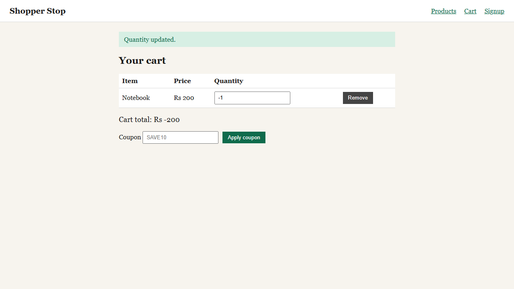
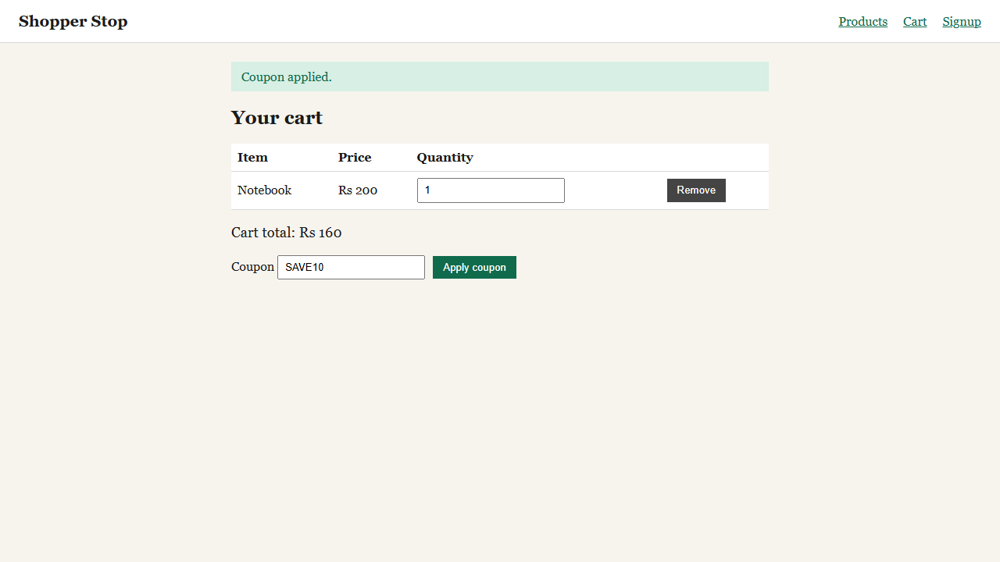
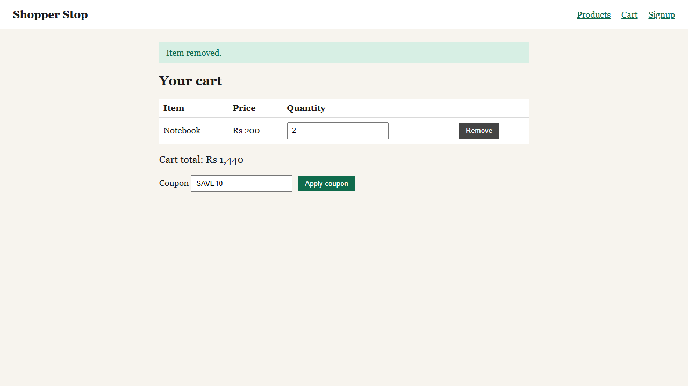
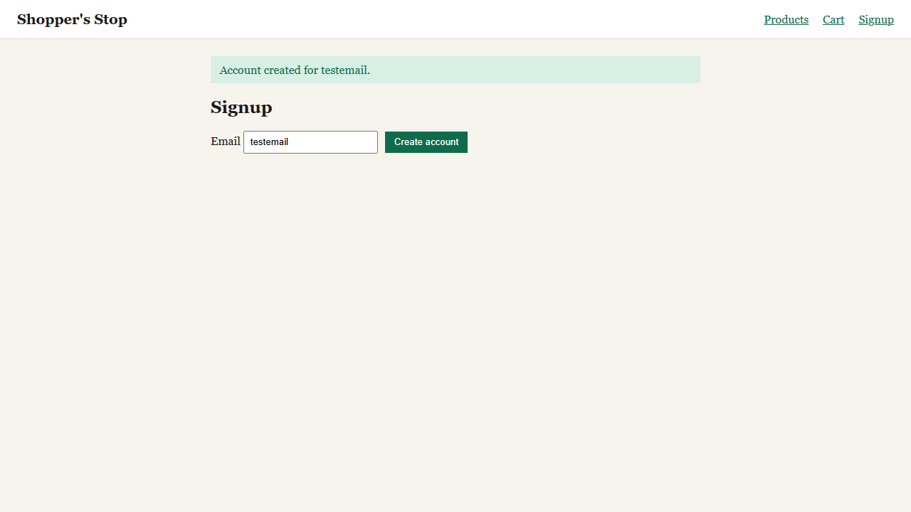

# Autonomous QA Tester Agent — Bug Report

**Generated:** 2026-10-10 23:28:06  
**Target URL:** http://localhost:3000  
**Planted BUGS Configuration:** `none`

## 1. Executive Summary

| Metric | Count |
|---|---|
| **Tests Executed** | 4 |
| **Tests Passed** | 0 |
| **Confirmed Bugs** (2/2 Independent Replays) | 4 |
| **Inconclusive Findings** | 0 |
| **Tests Could Not Complete** | 0 |

## 2. Clarification Questions & Answers Used

Before test execution, the agent analyzed the specification for ambiguities and resolved them:

- **Question:** What is the maximum quantity allowed per item in the cart?
  - **Answer Used:** `10` (Source: `answers.example.json`)

## 3. Confirmed Bugs

### Bug #1: [R1] Invalid or negative quantity accepted in cart

- **Severity:** **High** (Direct violation of core specification rule R1)
- **Specification Rule:** `R1`
- **Expected Behavior:** Quantity must be a positive integer (>= 1)
- **Actual Observed Result:** Cart accepted item 'Notebook' with quantity -1
- **Independent Verification:** `2/2` (Reproduced in 2 of 2 deterministic replays after state reset without LLM)

#### Steps to Reproduce
1. **CLICK** on `#add-p1` — *"Click 'Add to cart' on the first product to add an item to the cart so we can test modifying its quantity in the cart."*
2. **CLICK** on `#nav-cart` — *"Navigate to cart page to test quantity updates with 0 and negative numbers."*
3. **FILL** on `#qty-p1` with value `"0"` — *"Fill quantity input for p1 with 0 to test invalid quantity 0."*
4. **FILL** on `#qty-p1` with value `"-1"` — *"Attempt to update quantity to -1 to test negative quantity rejection as specified in the test objective."*

#### Screenshot Evidence

### Bug #2: [R3] Coupon applied multiple times to same order

- **Severity:** **Medium** (Direct violation of core specification rule R3)
- **Specification Rule:** `R3`
- **Expected Behavior:** Coupon discount must apply only once per order
- **Actual Observed Result:** Coupon applied 2 times: ['SAVE10', 'SAVE10']
- **Independent Verification:** `2/2` (Reproduced in 2 of 2 deterministic replays after state reset without LLM)

#### Steps to Reproduce
1. **CLICK** on `#add-p1` — *"To apply a coupon and test that it doesn't stack, I need to add items to the cart and go to the cart page."*
2. **CLICK** on `#nav-cart` — *"We have added an item to the cart. Now we need to navigate to the cart page to apply the coupon code."*
3. **FILL** on `#coupon-code` with value `"SAVE10"` — *"I need to enter a valid coupon code into the coupon input field to apply it for the first time."*
4. **CLICK** on `#apply-coupon` — *"I have filled the coupon code 'SAVE10' into the coupon input field. Now I need to click the 'Apply coupon' button to apply it for the first time."*
5. **CLICK** on `#apply-coupon` — *"The coupon SAVE10 has been applied once. To test rule R3 (Coupon applies only once per order), I need to click 'Apply coupon' again with the same coupon code to verify that it is rejected or ignored without adding extra discount."*

#### Screenshot Evidence

### Bug #3: [R4] Cart total calculation mismatch

- **Severity:** **High** (Direct violation of core specification rule R4)
- **Specification Rule:** `R4`
- **Expected Behavior:** Cart total should equal sum of items minus discount: Rs 360.0
- **Actual Observed Result:** Displayed/server total is Rs 1440
- **Independent Verification:** `2/2` (Reproduced in 2 of 2 deterministic replays after state reset without LLM)

#### Steps to Reproduce
1. **CLICK** on `#add-p1` — *"The objective is to add items to the cart, update quantities, apply a valid coupon, remove an item, and verify the cart total at each step. I will start by clicking 'Add to cart' on the first product."*
2. **CLICK** on `#add-p2` — *"I need to add more items to the cart or navigate to the cart page to verify the cart total. Let's add a second item to the cart."*
3. **CLICK** on `#nav-cart` — *"I need to view the cart to verify the cart total and perform cart modifications such as updating quantities, applying a coupon, and removing an item as specified in the test goal."*
4. **FILL** on `#qty-p1` with value `"2"` — *"We need to update item quantities within valid range, apply a valid coupon, and verify the cart total at each step. Let's first update the quantity of product 1 (qty-p1) to 2."*
5. **FILL** on `#coupon-code` with value `"SAVE10"` — *"I have added items and updated quantity. Now I need to apply a valid coupon to verify the cart total calculation with a discount."*
6. **CLICK** on `#apply-coupon` — *"I have filled in the coupon code 'SAVE10', now I need to click the 'Apply coupon' button to apply the discount and verify the cart total."*
7. **CLICK** on `#remove-p2` — *"I have added items, updated quantity, applied a valid coupon, and now I need to remove an item as specified in the test objective, and verify the cart total at each step. Currently, I'll click the 'Remove' button for the second item."*

#### Screenshot Evidence

### Bug #4: [R5] Invalid email address accepted during registration

- **Severity:** **Medium** (Direct violation of core specification rule R5)
- **Specification Rule:** `R5`
- **Expected Behavior:** Registration must reject invalid email formats
- **Actual Observed Result:** Server registered invalid email address: 'invalid-email-address'
- **Independent Verification:** `2/2` (Reproduced in 2 of 2 deterministic replays after state reset without LLM)

#### Steps to Reproduce
1. **CLICK** on `#nav-signup` — *"To test the signup with an invalid email address, I need to navigate to the Signup page first by clicking the Signup link."*
2. **FILL** on `#signup-email` with value `"invalid-email-address"` — *"I need to enter an invalid email address into the email input field to test that the signup form rejects invalid email addresses."*
3. **CLICK** on `#signup-submit` — *"Now that the invalid email is filled in, I need to click the 'Create account' button to submit the form and verify that the signup is rejected with a validation error."*

#### Screenshot Evidence

## 5. Methodology & Known Limitations

- **Verification Guarantee:** Only violations reproduced in 2/2 independent resets are reported as confirmed bugs.
- **Action Budget:** Tests are strictly bounded to 10 actions to prevent looping.
- **Scope:** Single-origin localhost execution only; external networks and third-party integrations are rejected by security design.
